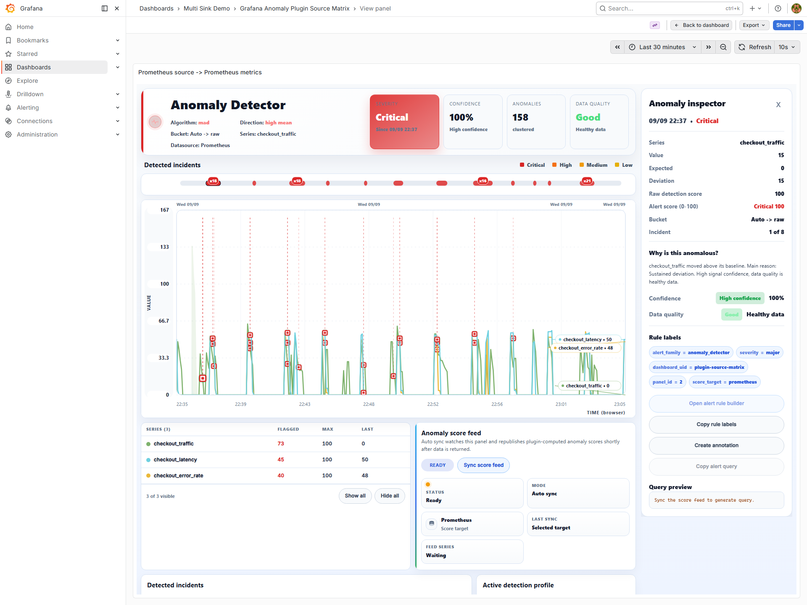
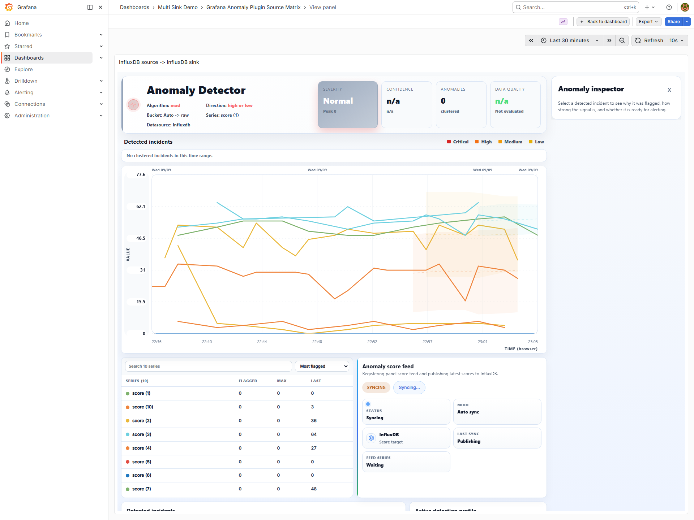
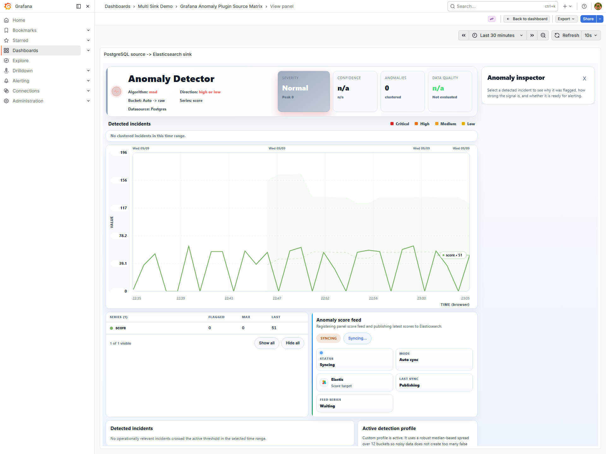

# Anomaly Detector 1.5.1: kurulum, kullanim ve operasyon

Bu kilavuz plugin ve exporter **1.5.1**, API schema **3** icindir.
Yayin durumu ve kabul kanitlari [surum durumunda](STATUS_v1.5.1.md) bulunur.
Dosyanin mevcut olmasi GitHub release'inin yayimlandigi anlamina gelmez.
Onceki PDF tarihsel referanstir; 1.5.1 ayarlari icin bu kilavuzu kullanin.

## 1. Bilesenler ve sorumluluklar

| Bilesen | Gorevi | Yapmadigi is |
| --- | --- | --- |
| Grafana plugin | Seriyi goruntuler, anomalinin nedenini aciklar, feed kaydi olusturur | Tek basina 7/24 sunucu zamanlayicisi degildir |
| Exporter | Kayitli sorguyu yeniden calistirir, hesaplar, secili hedefe yazar | E-posta gondermez; dashboard kullanicisinin oturumunu devralmaz |
| Kaynak datasource | Orijinal zaman serisini saglar | Skor deposu olmak zorunda degildir |
| Hedef/sink | Hesaplanan skoru alarm sorgusuna sunar | Kendi basina notification policy olusturmaz |
| Grafana Alerting | Skoru/deger durumunu sorgular, condition ve pending period uygular | Panelin acik olmasina bagli degildir |
| Contact point/policy | Firing/resolved bildirimini dogru aliciya tasir | Skor algoritmasini degistirmez |

Akis: kaynak -> exporter hesaplamasi -> secilen hedef -> Grafana alert rule -> policy -> alici.
Tarayici panelinde de ayni hesaplama kurallari kullanilir. Ayni skor icin yalniz
algoritma adi degil; sorgu, ornek zamanlari, aralik, step, bucket, gecmis ve tum
karar ayarlari ayni olmalidir. Canli sorgular farkli anlarda calisirsa son nokta
farkli olabilir; bu tek basina matematiksel parite hatasi degildir.

**InfluxDB -> InfluxDB icin Prometheus kurulumu gerekmez.** PostgreSQL -> Elasticsearch
gibi capraz akislar da desteklenir. Prometheus hedefinde exporter veriyi push etmez;
Prometheus `/metrics` endpoint'ini scrape eder. Diger hedeflerde exporter yazim yapar.
Bir panelde bir hedef secilir; `All` hedefi yoktur.

## 2. On kosullar ve erisim plani

- Plugin ID: `alpas-anomalydetector-panel`. Kimligini degistirmeyin.
- Exporter minimum Python: **3.9**. Yeni yerel Linux turu Python 3.12 ile yapildi.
- Plugin metadata Grafana >=11.6.7 bildirir; bu surumun son yerel UI turu 12.4.0 uzerindedir.
- Exporter servis kullanicisi kurulum, config ve dinamik state dizinine gereken erisime sahip olmali.
- Exporter kaynak API/DB'ye okuma, secilen hedefe yazma yetkisi ile erismeli.
- Grafana sunucusu alarm hedefini okuyabilmeli; Prometheus hedefinde scrape erisimi de gerekir.
- Tarayici sync icin exporter JSON API'sine ulasmali. Dogrudan 9110 yerine ayni Grafana
  HTTPS origin'i altinda LB proxy tercih edilebilir. Bu, backend icin yeni datasource erisimi saglamaz.
- Secret'lari dashboard JSON'a, sorguya, Git'e veya ekran goruntusune koymayin.
- Kurulumdan once mevcut config, plugin, dashboard ve state yedegi alin.

## 3. Plugin kurulumu

1. Ayni release'ten `grafana-anomaly-detector-plugin-1.5.1.zip`, exporter ZIP ve
   `SHA256SUMS_v1.5.1.txt` alin. Iki bileseni birlikte guncelleyin.
2. `sha256sum -c SHA256SUMS_v1.5.1.txt` ile indirme butunlugunu kontrol edin.
3. Grafana'nin **aktif** plugin dizinini servis argumanlari, `GF_PATHS_PLUGINS` ve
   baslangic logundan belirleyin. Tar dosyasinin konumu tek basina aktif dizini kanitlamaz.
4. Grafana'yi durdurun. Mevcut `alpas-anomalydetector-panel` dizinini plugin tarama
   dizini DISINDA yedekleyin; iki farkli kopyayi ayni dizinde birakmayin.
5. ZIP'i plugin dizinine acin. Bir ust klasor altinda `plugin.json` ve `module.js`
   olmali; gereksiz iki kat klasor olmamali. Grafana kullanicisi dosyalari okuyabilmeli.
6. Plugin unsigned ise aktif custom config'teki `[plugins]` bolumune
   `allow_loading_unsigned_plugins = alpas-anomalydetector-panel` ekleyin.
   Mevcut liste varsa diger plugin ID'lerini koruyun; `defaults.ini` degistirmeyin.
7. Grafana'yi baslatin, logda plugin yuklemesini ve UI'da 1.5.1 bilgisini kontrol edin.
   Plugin degisiminde Grafana restart ve tarayicida tam yenileme gerekir.

## 4. Exporter portable kurulumu

Asagidaki ornek `/data/anomaly` kurulum kokunu kullanir. Mevcut kurulumun ustune
dosya acmayin; once yedek alin. `python3.9` yerine kurulu desteklenen Python yolunu kullanabilirsiniz.

```bash
mkdir -p /data/anomaly
cd /data/anomaly
unzip /path/to/grafana-anomaly-exporter-bundle-1.5.1.zip
cd grafana-anomaly-exporter-bundle
python3.9 -m venv .venv
.venv/bin/python -m pip install -r exporter/requirements.txt
chmod +x portable-exporter.sh
export ANOMALY_PYTHON_BIN="$PWD/.venv/bin/python"
```

PostgreSQL kullaniliyorsa `exporter/requirements-postgresql.txt` bagimliliklarini
ayni venv'e kurun. Config dosyasi pakette vardir; ornek `up` sorgusu yalniz
kurulum kontroludur, latency alarmi olarak kullanilmaz.

### Prometheus kaynagi ve hedefi

```bash
cp exporter/examples/config.prometheus.yml exporter/config.yml
# config.yml icindeki query, labels ve detection ayarlarini duzenleyin.
./portable-exporter.sh validate
./portable-exporter.sh start http://127.0.0.1:8090
./portable-exporter.sh status
curl -fsS http://127.0.0.1:9110/health
curl -fsS http://127.0.0.1:9110/api/capabilities
```

`start` zaten calisan sureci guncellemez. Port/adres degistirirken dogru config ve
ortam degiskenleriyle `restart http://127.0.0.1:8090` kullanin. `status` ciktisinda
9090 goruluyorsa sadece YAML'a bakmayin; portable baslangic argumani ve kayitli
runtime ayarlari etkilidir. `logs`, `stop`, `foreground` komutlari da mevcuttur.
`foreground` terminal kapaninca 7/24 isletim saglamaz; kalici servis yonetimi gerekir.

Prometheus config'inde mevcut `scrape_configs` listesine ekleyin:

```yaml
scrape_configs:
  - job_name: anomaly_exporter
    scrape_interval: 15s
    static_configs:
      - targets: ['127.0.0.1:9110']
```

Bu dosyanin tamami degildir; mevcut job'lari silmeyin. `promtool check config`
ile kontrol edip mevcut servis prosedurunuzle reload edin. Container'da
127.0.0.1 ayni container'i gosterir; DNS/servis adresini buna gore secin.
Prometheus Targets'ta UP ve `grafana_anomaly_rule_score` sorgusunda veri beklenir.

### InfluxDB kaynagi ve hedefi

```bash
cp exporter/examples/config.influxdb.yml exporter/config.yml
export ANOMALY_SOURCE_INFLUX_ORG='your-org'
# Token'lari kurumunuzun secret yonetimiyle ortama alin; gecmise yazmayin.
read -rsp 'Source token: ' ANOMALY_SOURCE_INFLUX_TOKEN; echo
export ANOMALY_SOURCE_INFLUX_TOKEN
read -rsp 'Sink token: ' ANOMALY_SINK_INFLUX_TOKEN; echo
export ANOMALY_SINK_INFLUX_TOKEN
./portable-exporter.sh validate
./portable-exporter.sh start
```

Ornekte InfluxDB 2.x/Flux kullanilir. `url`, `org`, `bucket`, `measurement`, query
ve `token_env` ayarlarini duzenleyin. Kaynak bucket ile skor bucket'i ayri olsun;
kendi skorunu tekrar girdi yapmak geri besleme dongusudur. Ornekteki global
Prometheus URL'si Influx kaynak/hedef akisi icin baglanti gereksinimi degildir.

## 5. Exporter config referansi

### RHEL systemd alternatifi

Portable ve systemd'yi ayni 9110 portunda birlikte baslatmayin. Paket kokundeki
`install-exporter-rhel.sh` root ister ve desteklenen `python3` executable'ini
kullanir. Varsayilan kurulum `/opt/grafana-anomaly-exporter`, config
`/etc/grafana-anomaly-exporter`, state `/var/lib/grafana-anomaly-exporter`, log
`/var/log/grafana-anomaly-exporter` altindadir. Installer mevcut config/env'i korur.

```bash
sudo ./install-exporter-rhel.sh http://127.0.0.1:8090
sudo systemctl status grafana-anomaly-exporter
sudo journalctl -u grafana-anomaly-exporter -n 100 --no-pager
```

Installer'a INSTALL_ROOT/CONFIG_ROOT/USER override verirseniz hazir unit'teki
sabit WorkingDirectory, EnvironmentFile, ExecStart, User/Group ve ReadWritePaths
alanlarini da uyarlayin. Unit degisikliginden sonra `systemctl daemon-reload`,
ardindan restart gerekir. `/data` altinda app user ile basit kurulum icin portable
yontemini kullanin; unattended calisma icin kurumun servis yoneticisine entegre edin.
Hangi yontemde olursa olsun sirlarin yetkisini sinirlayin ve state'in yazilabilirligini kontrol edin.

### Global ayarlar

| Alan | Anlami / dikkat |
| --- | --- |
| `prometheus_url` | Prometheus kaynaklarinin varsayilan sorgu adresi; web UI portuyla karistirmayin |
| `evaluation_interval_seconds` | Backend dongu hedefi; dongu bu sureyi asiyorsa her bu aralikta sonuc garantisi yok |
| `request_timeout_seconds` | Kaynak istek zaman asimi; yavas sorgunun nedenini gizlemek icin sinirsiz artirmayin |
| `listen_host`, `listen_port` | Exporter bind adresi/portu; 0.0.0.0 istemci endpoint'i degildir |
| `config_reload_interval_seconds` | Config yeniden kontrol araligi; bind adresi degisince sureci yeniden baslatin |
| `base_path` | LB prefix'i korunuyorsa `/anomalyalarm`, kaldiriliyorsa bos |
| `cors_allowed_origins` | Izinli tarayici origin'leri; HTTPS scheme, host ve port dogru olmali |
| `api_token_env` | Bearer token'in tutuldugu ortam degiskeninin ADI; token degeri degil |
| `allowed_datasource_hosts` | Backend'in sorgulayabilecegi host allowlist'i; SSRF riskini sinirlar |
| `max_request_body_bytes` | JSON istek boyutu ust siniri; default ornekte 1048576 |
| `max_dynamic_rules`, `max_rules_per_panel` | Toplam ve panel basi kayit kotasi; ornekte 5000/50 |
| `max_query_length`, `max_feed_series` | Sorgu uzunlugu ve feed seri kotasi; ornekte 16384/1000 |
| `runtime_scope_ttl_seconds` | Gecici runtime kayitlarinin suresi; saved kayit yasam dongusu farklidir |
| `pushed_feed_ttl_seconds` | Tarayici preview verisinin omru; backend heartbeat yerine gecmez |
| `api_rate_limit_per_minute` | API istek siniri; 429 yanitini izleyin |

Portable launcher Python, config/state yolu, Prometheus URL, listen ve zamanlama
ortam degiskenleri gonderebilir. YAML degisikliginin etkin oldugunu `status`,
log ve API ile dogrulayin. `.portable-runtime` kalici state/operasyon verisidir;
cache sanip silmeyin. Config dosyasini okuma yetkisini servis kullanicisiyla sinirlayin.

### Kaynak ve hedef alanlari

`rules[].name` kalici kimlik; `query` kaynak sorgusu; `source_type` kaynak motoru;
`datasource_url` backend'den erisilen adres; `target_sinks` hedef secimidir.
`range_seconds` sorgu gecmisi, `step_seconds` sorgu adimi,
`bucket_span_seconds` skorlama oncesi toplama araligidir. `labels` routing ve
seri kimligini etkiler; sorgu metni gibi buyuk metadata'yi label yapmayin.
`aggregation` coklu seri sonucunun ozetlenmesini etkiler; orneklerde `max` vardir.

| Kaynak/hedef | Alarm sorgu dili | Kontrol |
| --- | --- | --- |
| Prometheus | PromQL | scrape UP, score ve backend tazelik metrikleri |
| Loki | LogQL | hedef log label'lari, rule kaydi, normalized_score unwrap |
| InfluxDB 2.x | Flux | org/bucket/token, rule kaydi ve skor alani |
| PostgreSQL | SQL | DB/schema/tablo, zaman kolonu, read/write yetkileri |
| ClickHouse | SQL | DB/tablo, zaman kolonu ve veri tipi |
| Elasticsearch | Elasticsearch sorgu modeli | index, zaman alani, sayisal skor mapping'i |

Her hedefin config semasi farklidir. Paketteki source/sink orneklerini ve API'nin
urettigi hedefe ozel query'yi kullanin; bir PromQL metnini SQL veya Flux alanina yapistirmayin.

## 6. Paneli hazirlama ve feed baslatma

1. Grafana datasource baglantisinda Save & test yapin. Panel sorgusunda zaman ve
   sayisal deger geldigini Query inspector ile kontrol edin; tabloda metin tek basina seri degildir.
2. Visualization olarak Anomaly Detector secin. Legend/alias'i kaynak sorguda ayarlayin;
   seriyi ayiran label'lari dusurmeyin. Farkli serilere ayni alias vermek incelemeyi zorlastirir.
3. Recommended ve uygun Metric type ile baslayin. Active detection profile'dan
   gercekte secilen algoritma, bucket, threshold ve yonu okuyun.
4. Score feed target'ta tek hedef, Exporter endpoint'te kullanicinin tarayicisindan
   erisilen API kokunu secin. Endpoint'e `/api/capabilities` veya `/metrics` eklemeyin.
5. Dashboard'u kaydedin. Sync score feed ile kayit olusturun ve kayit cevabini kontrol edin.
6. Status, Mode, Target, Last sync ve Feed series kartlarini kontrol edin. Sync tarihi
   tek basina backend'in halen kaynak okuyabildigini kanitlamaz; hedef tazeligini de sorgulayin.
7. Paneli kapatin; en az iki backend dongusu sonra hedefte zamanin ilerledigini,
   data state'in saglikli oldugunu ve kayitli sorgunun kaldigini teyit edin.

Auto sync UI guncellemelerini iletir. Manual sync kullanici aksiyonuyla iletir.
Off, panel tarafindaki yayini kapatir; daha once olusmus saved backend kurali
silinmis sayilmaz. Kurali durdurmak icin kayitli scope'u API/yonetim akisiyle
acikca kaldirin. Gecici runtime scope'u 7/24 saved kural yerine kullanmayin.

## 7. Recommended ve algoritmalar

Recommended, metric adi/turu ipuclarindan baslangic profili secer; etiketli veride
model egitimi veya otomatik optimum model aramasi yapmaz. Secimi profil kartindan
teyit edin. Harmonic'e otomatik gecis yoktur.

| Metric type | Model | Threshold | History | Varsayilan yon |
| --- | --- | --- | --- | --- |
| Traffic | EWMA | 4.5 | 30 | Both |
| Latency | MAD | 4 | 12 | High mean |
| Error rate | MAD | 4.5 | 12 | High mean |
| Resource | EWMA | 4.5 | 24 | High mean |
| Business | Seasonal | 4 | 8 | Both |
| Subtle level shift | Level shift | 5 | 30 | Both |

Availability/success/free capacity gibi isimlerde otomatik yon secimi farkli olabilir.
Yanlis metric ismi secimi bozabilir; kritik alarmda yonu ve modeli acikca kontrol edin.

| Algoritma | Nasil calisir / 1.5.1 degisikligi | Kullanim siniri |
| --- | --- | --- |
| Rolling z-score | Ortalama tabanli referans; kalici anomalinin baseline'i kirletmesine karsi guarded guncelleme | Her dagilim normal degildir |
| Rolling MAD | Medyan ve robust yayilim; bounded residual ve korelasyon farkindaligi | Cok duz/kuantize seride veri kalitesi ve sapma tabani onemli |
| EWMA | Guarded double-exponential referans; olayda trend sonumleme | Eskisinden farkli skor uretebilir; shadow karsilastirma yapin |
| Seasonal | Cycle >=8 icin guarded phase peers ve guven kontrollu drift duzeltme | Yanlis periyot, eksik gecmis; kisa cycle/calendar yollari farkli |
| Level shift | Damp edilmis EWMA referansi ve pencere kaniti; nokta agirligi 0.85 | Sustained change icindir; tek nokta alarmi ile ayni davranmaz |
| Harmonic (yeni, opt-in) | Bilinen dongu ve korelasyonlu gurultu icin bounded harmonik model | 8-4096 scored sample/dongu, en az iki tam dongu warm-up |

Harmonic'te 5 dakikalik bucket ile gunluk periyot 288'dir; 288 saniye degildir.
History alani Harmonic'in iki donguluk warm-up suresini azaltmaz. Daha fazla
algoritma detayi icin [Harmonic kilavuzu](../docs/HARMONIC_151_USAGE_TR.md).

## 8. Advanced tuning: her karar ayari

| UI / YAML | Anlami ve sonuc |
| --- | --- |
| Algorithm / `algorithm` | Advanced modda manuel model; kalibrasyonu modele gore yapin |
| Anomaly threshold / `threshold` | UI 0.2-10, adim 0.1, default 4. Ham istatistiksel esik; **0-100 alert skoru degildir** |
| History & warm-up / `baseline_window` | Z-score/MAD lookback, EWMA uyum, Seasonal peer derinligi; buyutmek gecmisi ve maliyeti artirir |
| Bucket span / `bucket_span_seconds` | Auto/raw/1m/5m/15m/1h; raw her ornegi korur, buyuk bucket kisa olaylari yumusatabilir |
| Season length / `seasonality_samples` | Bucket SONRASI dongudeki ornek sayisi |
| Seasonal refinement / `seasonal_refinement` | cycle, hour_of_day veya weekday_hour; Harmonic icin kullanilmaz |
| Anomaly direction / `anomaly_direction` | high_mean yalniz yukari; low_mean yalniz asagi; high_or_low iki yon |
| Minimum absolute deviation / `minimum_absolute_deviation` | Metric biriminde en kucuk anlamli fark; 0 kapatir |
| Minimum relative deviation / `minimum_relative_deviation` | Oransal fark; 0.10 = %10, 10 = %1000; 0 kapatir |
| Minimum activity / `minimum_activity` | Mevcut ve baseline birlikte bu tabanin altindaysa bastirir |
| Required anomaly buckets / `persistence_buckets` | N anomali kaniti gerekir; UI default 3 |
| Persistence window / `persistence_window` | Son M bucket; UI default 4; M >= N olmali |
| Recovery threshold / `recovery_threshold` | Olayi kapatmak icin daha dusuk raw esik; 0 acilis esigini kullanir |
| Recovery buckets / `recovery_buckets` | Ardisik iyilesme sayisi; UI default 2 |
| Cooldown / `cooldown_buckets` | Iyilesmeden sonra yeniden acmayi bastiran bucket sayisi; UI default 2 |
| Block degraded data / `data_quality_gate` | Thin/flatline/irregular veriden anomaly karari cikarmayi sinirlar; veri kesintisi icin watchdog gerekir |
| Severity preset / `severity_preset` | balanced, warning_first, page_first; raw score'un severity/0-100 haritalamasi |
| Detection mode | Single her seriyi ayri analiz eder; Multi ayni zamandaki sinyalleri birlikte ozetler |

**UI ile eksik alanli statik YAML default'lari ayni degildir.** Statik `RuleConfig`
geriye uyumluluk icin N=1/M=1, recovery=1, cooldown=0, quality gate=false kullanabilir.
Ornek YAML'larda 3/4 ve quality gate acikca yazilidir. Parite icin ayarlari acikca esleyin.

3/4, uc ardisik saniye veya Grafana uc kez eval demek degildir; skorlama bucket'idir.
Ayni zaman damgali tekrar veri yeni kanit olmamalidir. Grafana `for=10m` ayrica
pending suresi ekler. Evaluation=3m ise ilk true'dan sonra 10m dolan ilk eval'de
(duzenli akista yaklasik 12m sonra) firing olur; bu ilk true dahil bes gozlem olabilir.

Threshold yukseltmek genellikle daha az aday uretir; %100 precision garantisi vermez.
Bir esigi sadece mevcut alarmi susturmak icin degistirmeyin: etiketli normal/olay
araliklarinda precision, point recall/F1 ve gecikmeyi birlikte olcun.

## 9. Gorunum ve butonlar

Asagidaki goruntuler 1.5.1 yerel Grafana 12.4.0 labindan, 1920x1440 acik temada
alinmistir. Demo degerleri ve anlik severity, urunun her kaynakta ayni sonucu
uretecegi anlamina gelmez. Tam cozumunurluk icin resmi acin.



Inspector sagda olay nedenini, alttaki feed kartlari ise yayinin hedefini gosterir.
Confidence yuzdesi ile nitel Data quality durumu ayni olcum degildir.



Influx hedefi PromQL yerine Flux sorgusu uretir; Syncing gecici bir durumdur,
basarili kayit ve hedefte taze veri ile tamamlandigi ayrica kontrol edilir.



Kaynak PostgreSQL iken yazim hedefi Elastic olabilir. Hedef ikonu ve query dili
kaynagi degil yazilan depoyu temsil eder; rule builder'da da hedef datasource secilir.

| Alan/aksiyon | Davranis |
| --- | --- |
| Initial labels / Statistics | Baslik-context ve severity/confidence/quality ozetlerinin gorunurlugu |
| Main chart / Expected line-band | Actual ile beklenen referansi karsilastirma; band bir is SLA'si degildir |
| Series summary | Seri kimligi ve ozet degerleri; uzun liste sinirlanir/kaydirilir, veri silinmez |
| Detected incidents | Kume secimi, zaman seridinde navigasyon, inceleme icin olay secimi |
| Inspector | Value, Expected, Deviation, raw score, alert score ve neden aciklamasi |
| Open alert rule builder | Grafana yeni rule sayfasina gecis ve hedefe ozel query'nin panoya kopyalanmasi; otomatik rule kaydetmez |
| Copy rule labels | Onerilen routing label'larini panoya kopyalar; policy olusturmaz |
| Copy alert query | Secili hedefe uygun sorgu; kaynak query ile karistirmayin |
| Create annotation | Secilen olay icin Grafana annotation yazar; dashboard kaydi ve yetki gerekir |
| Sync score feed | Kayit/guncelleme ve feed durumu; capabilities ve target uyumlulugu gerekir |
| Detection profile | Gercekte etkin algoritma/preset ve karar politikasinin aciklamasi |
| Inline series labels | Cizginin kenarinda isim; legend'in yerini zorunlu olarak almaz |
| Anomaly focus band | Secili olayin yerel yakin gorunumu; varsayilan kapali |
| Time axis density/placement | Panel genisligiyle zaman etiketi sikligi ve ust/alt eksen yerlesimi |
| Marker style | Severity sekilleri veya klasik daire |
| Max anomalies in summary | Ozet olay sayisi limiti; skorlama/veri kaybina yol acmaz |
| Visible sections | Yalniz UI bolumleri; Score feed status'u gizlemek backend feed'i durdurmaz |
| Show export blocks | Ileri export bolumlerini gosterir; varsayilan kapali |

Rule builder basligi Folder - Dashboard - Panel baglamini tasir. Grafana surumu,
yetki ve datasource editorune gore on-doldurma sinirli olabilir; kaydetmeden once
name, datasource, query, labels ve condition'u tek tek kontrol edin. Yeni sekmede
bos query gorurseniz Copy alert query ile alin; bos sayfayi alarm kurulmus saymayin.
Tarayici clipboard izni reddedilirse kopyalama basarisiz olabilir; bildirimi kontrol edin.

## 10. Alarm olusturma ve bildirim

1. Secilen hedefin Grafana datasource'unu olusturun; kaynak datasource otomatik hedef olmaz.
2. Panelde feed kaydini ve hedefte taze rule kaydini teyit edin.
3. Open alert rule builder, ardindan hedefe ozel query'yi kullanin. `score` icin
   last/max reduce + `>95` bir ornektir; 95 raw threshold yerine konmaz.
4. Olay yasam dongusunu izlemek istiyorsaniz API/panelin active query'sini kullanin.
   Skor ve active-state alarmi farkli sorulari cevaplar; birini digerinin yerine varsaymayin.
5. N-of-M ve Grafana pending period'un toplu gecikmesini hesaplayin. Baslangic icin
   kurumsal SLO'ya uygun for/evaluation secin; her ortamda 10m ideal degildir.
6. `noDataState=OK` ve `execErrState=OK` ile sessiz korluk olusturmayin. NoData/Error
   durumlarini ayri policy ile operasyon contact point'ine yonlendirin.
7. Watchdog ile exporter erisimi, backend son basarili veri zamani, sink basarisi ve
   kuyruk/drop durumunu izleyin. Eski bir skor kaydi halen sorgulanabiliyor diye akis saglikli degildir.
8. Gercek test alicisinda firing VE resolved mail/webhook gorun. Silence'in kapsamini
   ve normal alarmlari etkilemedigini test edin. Teslim testi bu labda yapilmamistir.

Default subject genis CommonLabels nedeniyle uzun olabilir. Routing icin gerekli
az sayida label kullanin; query, dashboard aciklamasi gibi uzun metadata'yi annotation'a
koyun. Var olan policy/silence matcher'larini kontrol etmeden label kaldirmayin.

## 11. /anomalyalarm LB ve guvenlik

Tarayici endpoint'i: `https://grafana.example.com/anomalyalarm`.

| LB islemi | Backend istegi | base_path |
| --- | --- | --- |
| Yalniz `/anomalyalarm` onekini kaldirir | `/api/capabilities` -> exporter:9110 | bos |
| Oneki aynen korur | `/anomalyalarm/api/capabilities` -> exporter:9110 | `/anomalyalarm` |

LB tum istekleri `/` adresine cevirmemeli. Method, kalan path, query ve body
korunmali; POST/DELETE/OPTIONS dahil. `/api/capabilities` JSON dondurmelidir,
Prometheus text metrics veya Grafana HTML login sayfasi degil. Bilinmeyen API
path'inin 404 JSON olmasi beklenir. `/metrics` text exposition'dir.
Auth uygulanmissa 401/403 kontrollu olarak beklenir; sorunu wildcard CORS veya
tarayici guvenligini kapatarak cozmeyin. LB exporter token'ini ekliyorsa giris
tarafinda kullanici yetkilendirmesi yapmali; her Grafana viewer'a yazim yetkisi vermeyin.

Detayli path matrisi: [proxy kilavuzu](../docs/ANOMALYALARM_PROXY_TR.md).
Yerel root/prefix testleri kurumsal LB'nin dogru oldugunu kanitlamaz.

## 12. Upgrade, yedek ve geri donus

1. Mevcut plugin/exporter versiyonunu, config yolunu, baslatma argumanlarini ve
   dosya hash'lerini kaydedin. Rule registry'nin gercek yolunu bulun.
2. Bildirim etkisini planlayin; algoritma degisimi ayni threshold'da farkli skor uretebilir.
   Gerekiyorsa dar kapsamli bakim silence'i kullanin; tum kurum bildirimlerini kapatmayin.
3. Exporter'i durdurun, config, secret/env dosyasi ve **gercek dinamik state** dosyasini
   erisim kontrollu yedekleyin. Grafana DB yedegini DB tipine uygun tutarli yontemle alin.
4. Yeni exporter'i ayri dizine acin. Yeni bos state'i eski kayitlarin ustune yazmayin.
   `ANOMALY_CONFIG_PATH` ve `ANOMALY_DYNAMIC_RULES_PATH` ile kalici dosyalari esleyin.
5. Ornek config'leri mevcut config ile karsilastirin; ornegi mevcut config ustune kopyalamayin.
   Validate edin. Yeni requirements'i ayri venv'e kurun.
6. Exporter ve plugin'i esli guncelleyin. Capabilities icinde yeni kernel desteklerini
   kontrol edin; yalniz 1.5.1 yazmasi ayni build oldugunu kanitlamaz.
7. Grafana'yi yeniden baslatin. Bir pilot dashboard'da saved kayit, score sorgusu,
   panel kapali feed ve test bildirimi kontrolu yapin; sonra yayginlastirin.
8. Geri donuste eski ikiliyi VE uyumlu yedek config/state'i kullanin. Canli dinamik
   dosyayi calisan exporter altinda degistirmeyin. Geri donus sonrasi tekrar feed testi yapin.

Uninstall script'i upgrade araci degildir; config/state kaybina yol acabilir.
Eski GitHub tag'leri ve ZIP'ler yeni build ile sessizce degistirilmez.

## 13. Kabul ve sorun giderme

| Belirti | Kontrol / neden |
| --- | --- |
| Config file not found | ZIP kokundeki exporter/config.yml, ANOMALY_CONFIG_PATH, kullanici izinleri |
| Address already in use | 9110'u dinleyen PID; baska servisi rastgele oldurmeyin |
| Sync failed to fetch | Tarayici Network: HTTPS/HTTP, CORS, LB path, auth, endpoint erisimi |
| API isteginde metrics | LB suffix'i siliyor veya yanlis backend; JSON path'lerini ayri test edin |
| Rules=0 | Kayit cevabi, saved scope, desteklenen kaynak target/query, config yetkisi |
| Warm-up / skor yok | Yeterli gecmis, period ve bucket; missing veriyi 0'a cevirmeyin |
| Panel kapaliyken zaman duruyor | Runtime preview yerine saved source query var mi; exporter kaynak yetkisi ve state yolu |
| Hedef saglikli ama eski veri | Yazim sayaci, son sample tarihi, kuyruk/backpressure ve data state |
| Surekli candidate | N/M, yon, min deviation/activity, quality gate ve recovery ayarlari |
| 3m interval'de gec bildirim | N/M + pending + policy group_wait + query/sink dongu suresi birlikte etkili |

Yerel kabul komutlari repository kokunde, test servisleri uzerinde calistirilir:

```text
python scripts/detection_quality_check.py
python -m unittest discover -s prometheus-live-demo/anomaly_exporter/tests
python scripts/local_ui_gate.py --local-lab
python scripts/local_deploy_audit.py
```

UI/audit icin QA_GRAFANA_USER/PASSWORD ortami gerekir. UI testi gecici fixture
olusturur; uretimde calistirmayin. Fault testleri, 36 rota testi ve soak ayri
kapsamlardir. Sentetik precision/F1 PASS; her saha dagiliminda kusursuz tespit
veya kesintisiz bildirim garantisi degildir. Gercek etiketli olay replay'i,
donanim yuk/SLO, kurum yetkilendirmesi ve alici teslimi devreye alma kriterleridir.
